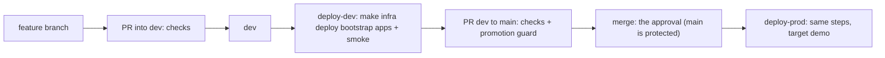

# CI/CD: dev to production in one workspace

There is one Databricks workspace. It hosts two environments, and every repo (this one and the ten agent repos) has two long-lived
branches, one for each.

| | `main` | `dev` |
|---|---|---|
| Environment | production (`demo`) | pre-production (`dev`) |
| Bundle target and profile | `demo`, `config/env/demo.yaml` | `dev`, `config/env/dev.yaml` |
| Apps | `eqds-ui`, `eqds-moderator`, `eqds-bridge-mcp`, `eqds-sp-<key>` | the same with `-dev` |
| Jobs | `eqds-<job>-demo` | `eqds-<job>-dev`, schedules paused |
| Unity Catalog | `eqds_demo.prod` | `eqds_dev.dev` (data), `eqds_dev.traces` (traces) |
| Lakebase | project `eqds-lakebase`, branch `production` | same project, branch `dev` |
| Experiments | `/Shared/eqds/demo`, `-moderator`, `-<key>` | `/Shared/eqds-dev/eqds`, `-moderator`, `-<key>` |
| Traces | MLflow storage | Unity Catalog tables in `eqds_dev.traces` |
| Model services, SQL warehouse, vector index, Genie | named with the suffix / in the catalog | `-dev`, `eqds_dev` |
| Service principals (apps, registrar, job caller) | production's | their own, created by the dev deploy |

What dev **borrows** from production (profile key `shared_external: true`): the external Azure SQL database, with its UC connection
`azure_oms_conn` and foreign catalog `azure_oms`, the secret scope, and the vector search endpoint `eqds-vs` (only the index is per
environment). Dev only reads the database: `seed_azure` and `news_generator` refuse to run, `make seed` skips `seed_azure`, and bootstrap
teardown keeps the connection and foreign catalog.

## Flow

- PR into `dev` or `main`: ruff, manifest check, tests, `bundle_vars` for both targets. A PR into `main` must come from `dev`.
- Push to `dev`: `deploy-dev` runs `make infra preflight deploy bootstrap apps outputs` for target `dev`, then `make smoke --jobs`
  (apps active, `/healthz`, registry listing, the `validate_seed` job).
- Push to `main`: `deploy-prod` runs the same steps for target `demo`. `main` is protected (pull request plus the `checks` status), so the
  merge of the `dev` to `main` PR is the approval. If the GitHub plan supports required reviewers on environments (not the case for the
  private repos on this plan: the API refuses), add them to the `production` environment and the run will also wait for a reviewer.
  `workflow_dispatch` with a `ref` redeploys an older tag or commit (rollback).
- Jobs follow the same path: one definition, deployed first to dev (paused schedules; run on demand, `make seed TARGET=dev`), then
  promoted by merging. The `demo` profile turns the schedules on.
- Agent repos have the same three workflows. They check out the platform repo (its `dev` or `main` branch) because the build vendors the
  runtime from it, deploy with `make deploy TARGET=dev|demo`, bind the agent's trace tables, and smoke-test `/healthz` and `/info`.

## What `make infra TARGET=dev` creates (idempotent)

- Catalog `eqds_dev`, schema `eqds_dev.traces` (the data schema `dev` comes from the bundle), workspace folder `/Shared/eqds-dev`.
- The Lakebase branch `dev`, created from `production` (copy-on-write) with its own read-write endpoint. **At creation its runtime data is
  reset** (registry, memory, runs, bridge queue, checkpoints): the copied registry rows would point the dev moderator at production agents.
  A later run finds the branch and touches nothing. The dev bootstrap then applies migrations and roles for the dev service principals.
- Secret scope, vector search endpoint and the job-caller principal, as for any environment.

## Traces in `eqds_dev`

`flags.use_uc_trace_storage: true` in `dev.yaml`. After `bundle deploy` (which creates the experiments), the bootstrap step
`trace_storage` binds every experiment under the dev folder to `eqds_dev.traces` with the table prefix of the experiment's leaf name
(`eqds_otel_spans`, `eqds_moderator_otel_spans`, `eqds_news_otel_spans`, ...), and grants: writers MODIFY + SELECT on their four tables,
the UI SELECT on the schema (the run trace view reads it through the warehouse). Agent repos do the same for their own experiment in
`make traces`, before the app starts. Things to know:

- The binding is permanent and does not move older traces. Production stays on MLflow storage.
- `ALL PRIVILEGES` is not enough on trace tables; the grants name MODIFY and SELECT.
- Reading UC traces uses a SQL warehouse (`MLFLOW_TRACING_SQL_WAREHOUSE_ID`, set from `DATABRICKS_WAREHOUSE_ID`).

## One-time setup

1. GitHub, platform repo: repository variable `DATABRICKS_HOST` (set); environments `dev` and `production` (created), each with secrets `DATABRICKS_CLIENT_ID` and `DATABRICKS_CLIENT_SECRET` of the CI service principal for it. First run only:
   `EQDS_AZURE_SQL_USER` / `EQDS_AZURE_SQL_PASSWORD` if the secret scope does not hold them yet (dev shares production's scope, so it does).
2. The CI service principal needs: create catalogs and schemas, manage the Lakebase project (it creates the dev branch and connects to it
   with a Postgres role; grant one on `production` before the branch is created so the copy carries it), and `CAN_USE` on the warehouse.
3. Agent repos: repository variables `DATABRICKS_HOST` and `PLATFORM_REPO` (set), secret `PLATFORM_REPO_TOKEN` (read access to the platform
   repo), and the same two environments with the CI credentials.
   Secrets are not set yet: until they are, the workflows fail at the Databricks login and deploys are done from a workstation with
   `make deploy TARGET=dev|demo`.
4. Branch protection on `main` of every repo (set): a pull request and the `checks` status of the `pr` workflow. Default branch is `dev`.
5. From a workstation, once: `make registrar TARGET=dev` (creates the dev registrar service principal and records it in `dev.yaml`),
   `make all TARGET=dev`, `make seed TARGET=dev`, then, from the platform repo, `python scripts/new_agent.py <key> --scaffold-update` for
   each agent so its bundle gets the `dev` target (it needs the dev apps' service principals, so the dev platform has to be deployed first).
   Agents are registered by hand on the **dev** UI.

## Registrar identity

The registration job runs as the registrar service principal. Granting a person (or the CI principal) the role 'Service Principal User' on it
is an admin-console step (no API in this workspace). Until that is done for `eqds-registrar-dev`, `dev.yaml` has
`registrar_job_identity: deployer`: the job runs as whoever deploys, the principal still exists and holds the agents' app permissions.
After the grant, delete that line and redeploy dev.

## Adding another environment

A new environment is a profile plus a target: copy `config/env/dev.yaml`, change the suffix, catalog, Lakebase branch, experiment
folder and `shared_external`, add a `targets:` entry, and a workflow that calls `_deploy.yml` with the new target.
